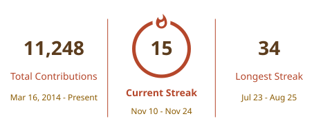

# Hi there, I am Zadkiel 👋

Linux lover, cloud native builder and open source maintainer from Toulouse, France. I work on developer platforms, mostly making Kubernetes, GitOps and delivery a bit less painful for the teams using them. Currently Cloud Specialist at **Airbus Aircraft** and DevOps consultant at **CCL Consulting**.

## About me

* 💼 Full-stack developer turned platform engineer
* ☁️ Kubernetes across public and sovereign clouds, on-prem and the edge
* 🧰 Specialized in developer experience, GitOps, and multi-cloud automation
* 💡 Active open-source maintainer and community advocate
* 📜 Certified Kubernetes Administrator (CKA) and Kubernetes Security Specialist (CKS)
* 🤖 Exploring how agentic AI reshapes platform engineering
* 🏢 10 years across aerospace, retail, and consulting
* 🎓 MSc in Cybersecurity (University of Kent) and Engineering degree (EPITECH)
* 🌍 Toulouse, France, open to full remote

## Projects I maintain

- [aslafy-z/helm-git](https://github.com/aslafy-z/helm-git) - Helm Plugin - Install Helm Charts straight from Git repositories
- [stakater/application](https://github.com/stakater/application) - Generic helm chart for all kind of applications
- [aslafy-z/plein](https://github.com/aslafy-z/plein) - Multi-country PWA that finds the cheapest fuel stations around you and along your route
- [ccl-consulting/fleeting-plugin-scaleway](https://gitlab.com/ccl-consulting/fleeting-plugin-scaleway) - GitLab Runner auto-scaling plugin for Scaleway cloud provider
- [swapagarwal/swag-for-dev](https://github.com/swapagarwal/swag-for-dev) - 😎 swag opportunities for developers
- [aslafy-z/aur-packages](https://github.com/aslafy-z/aur-packages) - Collection of Arch Linux AUR packages
- [kube-logging/logging-operator](https://github.com/kube-logging/logging-operator) - Logging operator for Kubernetes, as core contributor

## 👷 What I'm currently working on

* Cloud-native and edge platforms for next-generation onboard aircraft systems at **Airbus**
* **ROS2 Dashcam**: a Jetson-powered computer vision system for edge video processing
* **Homelab**: a multi-zone Talos Linux Kubernetes cluster, fully GitOps-driven with Argo CD, Cilium, Rook-Ceph storage, Keycloak SSO, and self-hosted services
* Kubernetes compliance, self-service platform tooling, and GitOps workflows at **CCL Consulting**
* Maintaining open-source tools and Helm plugins for the Cloud Native ecosystem

and more...

- [DataHearth/streamline](https://github.com/DataHearth/streamline) - Self-hosted media manager for movies, TV, music and books. One Go binary replaces Radarr, Sonarr, Lidarr, Readarr and Seerr: web UI, REST API, requests, SSO, a built-in BitTorrent client, and WebAssembly extensions for the Streamline Player, Subsonic and OPDS. (17 hours ago)
- [Jackett/Jackett](https://github.com/Jackett/Jackett) - API Support for your favorite torrent trackers (2 days ago)
- [aslafy-z/coreruleset-plugins-image](https://github.com/aslafy-z/coreruleset-plugins-image) - OWASP CRS plugins as a minimal, signed OCI image for Coraza/Envoy WAFs. (2 days ago)
- [aslafy-z/plein](https://github.com/aslafy-z/plein) - A full tank at the right price — PWA that finds the cheapest fuel stations around you and along your routes (France · Spain · Andorra · Portugal) (1 week ago)
- [aslafy-z/cloudstream-plugins](https://github.com/aslafy-z/cloudstream-plugins) - CloudStream plugins for French replay TV. (3 weeks ago)
- [recloudstream/cs-repos](https://github.com/recloudstream/cs-repos) - Cloudstream plugin repositories (4 weeks ago)
- [recloudstream/cloudstream](https://github.com/recloudstream/cloudstream) - Android app for streaming and downloading media. (4 weeks ago)
- [scaleway/packer-plugin-scaleway](https://github.com/scaleway/packer-plugin-scaleway) - Packer plugin for Scaleway Builder (4 weeks ago)
- [aslafy-z/aur-packages](https://github.com/aslafy-z/aur-packages) - AUR packages collection (1 month ago)
- [LibreHardwareMonitor/LibreHardwareMonitor](https://github.com/LibreHardwareMonitor/LibreHardwareMonitor) - Libre Hardware Monitor is free software that can monitor the temperature sensors, fan speeds, voltages, load and clock speeds of your computer. (1 month ago)

## 🔭 Latest releases I've contributed to

- [Jackett/Jackett](https://github.com/Jackett/Jackett) ([v0.25.39](https://github.com/Jackett/Jackett/releases/tag/v0.25.39), 1 day ago)
- [aslafy-z/coreruleset-plugins-image](https://github.com/aslafy-z/coreruleset-plugins-image) ([2026.11.3](https://github.com/aslafy-z/coreruleset-plugins-image/releases/tag/2026.11.3), 2 days ago)
- [DataHearth/streamline](https://github.com/DataHearth/streamline) ([v4.0.0](https://github.com/DataHearth/streamline/releases/tag/v4.0.0), 4 days ago)
- [namecheap/terraform-provider-jenkins](https://github.com/namecheap/terraform-provider-jenkins) ([v1.5.0](https://github.com/namecheap/terraform-provider-jenkins/releases/tag/v1.5.0), 6 days ago)
- [aslafy-z/plein](https://github.com/aslafy-z/plein) ([release-2026-11-18](https://github.com/aslafy-z/plein/releases/tag/release-2026-11-18), 1 week ago)
- [anacrolix/torrent](https://github.com/anacrolix/torrent) ([v1.62.0](https://github.com/anacrolix/torrent/releases/tag/v1.62.0), 1 week ago)
- [recloudstream/cloudstream](https://github.com/recloudstream/cloudstream) ([v4.9.0](https://github.com/recloudstream/cloudstream/releases/tag/v4.9.0), 2 weeks ago)
- [stakater/application](https://github.com/stakater/application) ([v9.3.2](https://github.com/stakater/application/releases/tag/v9.3.2), 2 months ago)
- [aslafy-z/hauth](https://github.com/aslafy-z/hauth) ([v0.1.15](https://github.com/aslafy-z/hauth/releases/tag/v0.1.15), 2 months ago)
- [martabal/qbittorrent-exporter](https://github.com/martabal/qbittorrent-exporter) ([v2.0.2](https://github.com/martabal/qbittorrent-exporter/releases/tag/v2.0.2), 3 months ago)

## 🔨 Recent Pull Requests

- [fix(web): correct web texts, i18n gaps and layout slips from #356](https://github.com/DataHearth/streamline/pull/372) on [DataHearth/streamline](https://github.com/DataHearth/streamline) (12 hours ago)
- [docs(api): correct the #356 texts against the code](https://github.com/DataHearth/streamline/pull/371) on [DataHearth/streamline](https://github.com/DataHearth/streamline) (12 hours ago)
- [fix(music): fix the music, request and indexer findings from #356](https://github.com/DataHearth/streamline/pull/370) on [DataHearth/streamline](https://github.com/DataHearth/streamline) (12 hours ago)
- [fix(auth): fix the auth, extension and server findings from #356](https://github.com/DataHearth/streamline/pull/369) on [DataHearth/streamline](https://github.com/DataHearth/streamline) (13 hours ago)
- [fix(library): four #356 library, importer and series fixes](https://github.com/DataHearth/streamline/pull/368) on [DataHearth/streamline](https://github.com/DataHearth/streamline) (13 hours ago)
- [fix(download): fix six download and import findings from #356](https://github.com/DataHearth/streamline/pull/367) on [DataHearth/streamline](https://github.com/DataHearth/streamline) (13 hours ago)
- [fix(books): keep, answer and review book metadata changes](https://github.com/DataHearth/streamline/pull/366) on [DataHearth/streamline](https://github.com/DataHearth/streamline) (13 hours ago)
- [perf(player): show the video layer only while something plays](https://github.com/Streamline-HQ/streamline-player/pull/9) on [Streamline-HQ/streamline-player](https://github.com/Streamline-HQ/streamline-player) (21 hours ago)
- [feat(account): let an account turn title logos off](https://github.com/DataHearth/streamline/pull/364) on [DataHearth/streamline](https://github.com/DataHearth/streamline) (23 hours ago)
- [perf(home): a still backdrop and a stepped progress bar where the webview draws on the CPU](https://github.com/Streamline-HQ/streamline-player/pull/8) on [Streamline-HQ/streamline-player](https://github.com/Streamline-HQ/streamline-player) (1 day ago)

[View all pull requests →](https://github.com/search?q=is%3Apr+author%3Aaslafy-z+-user%3Aaslafy-z&type=pullrequests)

## ⭐ Recent Stars

- [paimonsoror/telltaledns](https://github.com/paimonsoror/telltaledns) - A small, fast DNS resolver and ad blocker that explains every answer. Per-device rules, encrypted DNS, and clustering across a Raspberry Pi and Kubernetes. (2 days ago)
- [labstack/pitot](https://github.com/labstack/pitot) - Single-binary observability platform. Ingest OTLP, store as Parquet, query with DuckDB. (1 week ago)
- [lukashankeln/glint](https://github.com/lukashankeln/glint) - lint ArgoCD Applications, FluxCD HelmReleases and plain Resources using custom CEL Policies (3 weeks ago)
- [stablyai/orca](https://github.com/stablyai/orca) - Orca lets you run a fleet of bots with your own subscription (e.g. Claude Code, Grok, Agy, Codex). Available on desktop, mobile and remote runtime. (3 weeks ago)
- [Fluepke/emudrahahahahaha](https://github.com/Fluepke/emudrahahahahaha) - Private Keys (1 month ago)
- [argoproj-labs/argocd-agent](https://github.com/argoproj-labs/argocd-agent) - Redefining the multi cluster story of Argo CD (1 month ago)
- [rayfish/rayfish](https://github.com/rayfish/rayfish) - Peer-to-peer mesh VPN over iroh. Connect computers, phones, and servers without an account or control server. (1 month ago)
- [GrowlyX/tailmux](https://github.com/GrowlyX/tailmux) - Stay on multiple Tailscale tailnets at once! (1 month ago)
- [PimpinPumpkin/Vela](https://github.com/PimpinPumpkin/Vela) - Maps and turn-by-turn navigation for Android without Google Play Services: the best of open map data, with Google lookups by choice. Runs on degoogled phones and can avoid Flock cameras (1 month ago)
- [bookorbit/bookorbit](https://github.com/bookorbit/bookorbit) - BookOrbit: Your Reading Space (1 month ago)

[View all stars →](https://github.com/aslafy-z?tab=stars)

## 📈 Stats

  <picture>
    <source media="(prefers-color-scheme: dark)" srcset="./stats-dark.svg" />
    
  </picture>
  <picture>
    <source media="(prefers-color-scheme: dark)" srcset="./streak-dark.svg" />
    
  </picture>

## 📫 Reach me

  
  
  
  
  
  
  

